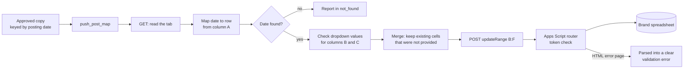

# Sheet Push Router

**Outcome: Content that ships on time**

> **Details removed.** Company names, people, accounts and data were taken out. The logic is how I built it.

## The problem

Approved social posts lived in one content calendar spreadsheet per brand. Each row is a posting date. Someone copied every write-up and caption into the right row by hand. Rows moved when the team changed the schedule. Dropdown columns rejected values that did not match their list, and the error came back as a web page, so batch pushes crashed half way with no clear reason.

## What it does

One small Python client and one Apps Script web app. The client finds the right row by date, merges new copy with what is already there, and writes a whole row in one call. The web app is a single router that can reach every spreadsheet the deploying account can edit.



## How it works

1. **Resolve the brand.** `config.json` maps a brand name or alias to its spreadsheet id.
2. **Read before write.** The client reads the tab and builds a date to row map from column A. Row numbers are never hard coded, because they drift when the team edits the schedule.
3. **Validate.** Values for the two dropdown columns are checked against the allowed lists. Bad values are reported in `validation_warnings`.
4. **Merge.** For each matched date the client builds the B to F row. Any cell you did not provide keeps its current value, so a caption-only push never blanks the write-up, and the last column is never wiped by accident.
5. **Route.** The Apps Script web app checks a shared token, opens the spreadsheet by id, and runs one of a small set of ops: read, write cell, update range, append, clear, delete row, list tabs, read and write notes, and read, add or delete comments.

## The human check

Nothing is pushed until a person has approved the copy. The router only ever writes the copy columns; date, approval, file and posting status columns stay human-owned. The return value lists every row written, every date not found, and every dropdown warning, so the person pushing can check the result line by line.

## Failure handling

- **Validation rejections.** Apps Script answers HTTP 200 with an HTML page when a sheet's validation rejects a write. The client spots non-JSON, pulls out the "The data you entered..." message, and returns a structured error instead of crashing on `json.loads`.
- **Read fails, nothing writes.** If the first read returns an error, the push stops before any write.
- **Missing secrets fail early.** No URL or token in the environment raises a clear error before any network call.
- **Network and HTTP errors** come back as `{"error": ...}` dictionaries, never exceptions in the middle of a batch.
- **Router errors** are caught per op and returned as JSON. Unknown ops and missing sheets are named in the error.
- **Comments** try Drive API v3 first and fall back to v2, and report which one worked.

Two traps worth knowing:

- **Dates come back as UTC.** A sheet set to a timezone ahead of UTC shows the next calendar day. Check the tab's cadence before mapping a date to a row.
- **One bad dropdown value rejects the whole B:F write.** For copy-only pushes, write D:F or E:F and leave the dropdown columns alone.

## How to run it

**Deploy the router (once)**

1. Create a new Apps Script project. Paste `appscript/Code.gs` and `appscript/appsscript.json` (turn on "Show appsscript.json" in Project Settings).
2. Project Settings, Script Properties: add `ROUTER_TOKEN` with a long random value.
3. Optional: Services, add Drive API, for the comment ops.
4. Deploy as a web app. Execute as: me. Access: anyone. Copy the `/exec` URL.
5. The deploying account needs edit access to every target spreadsheet. Its permissions are the real access boundary, and the token is the gate in front of it.

**Use the client**

```bash
cp config.example.json config.json            # add your spreadsheet ids and aliases
export SHEET_ROUTER_URL="https://.../exec"
export SHEET_ROUTER_TOKEN="same value as ROUTER_TOKEN"
python3 push_to_sheets.py verticals
python3 push_to_sheets.py list-sheets a
python3 push_to_sheets.py read a "June"
python3 -m unittest discover -s tests         # offline tests, the router is faked
```

From Python:

```python
from push_to_sheets import push_post_map
push_post_map("a", "June", {"Monday, June 1": {"fb_caption": "...", "linkedin_caption": "..."}})
```

A note on the design: the GET read sends the token as a query parameter because Apps Script web apps cannot read request headers. Keep the token long, rotate it if it leaks, and keep the deployment's edit access narrow.

## Files

| File | What it does |
|---|---|
| `push_to_sheets.py` | Client: brand lookup, read, write, clear, date-matched row push, CLI |
| `appscript/Code.gs` | Router web app: token check and all ops |
| `appscript/appsscript.json` | Manifest: V8, web app access, spreadsheet scope |
| `config.example.json` | Brand to spreadsheet map with placeholder ids |
| `.env.example` | Placeholder URL and token |
| `tests/test_push.py` | Error parsing, env check, row matching, merge and warnings |
