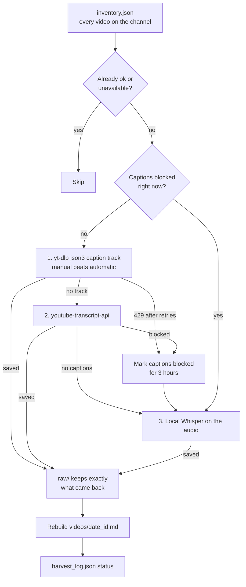

# Transcript Harvester

**Outcome: Hours back every week**

> **Details removed.** Company names, people, accounts and data were taken out. The logic is how I built it.

## The problem

A marketing team needed every word a public speaker had said on video, so writers could quote and study the real voice instead of guessing. That meant hundreds of videos. Copying captions by hand was slow and error prone. Captions were also missing on some videos, and YouTube blocks scripts that ask too often.

## What it does

It walks a channel's full video list and saves one Markdown transcript per video. It tries the fastest honest source first and falls back to local speech-to-text when captions are blocked or missing. It runs unattended in short batches and picks up where it stopped.



## How it works

1. **Inventory.** `harvest.py inventory <channel_url>` lists every upload into `inventory.json`. Playlists can be added by hand. Videos that only sit in "guest" playlists are fetched last, so the host's own talks come first.
2. **Captions first.** yt-dlp reads the video metadata and the json3 caption track. Manual English captions win over automatic ones. A 429 waits 30 seconds, then 90, then gives up.
3. **Second engine.** If yt-dlp finds no track, `youtube-transcript-api` tries next.
4. **Whisper fallback.** If captions are blocked or do not exist, the script downloads the audio and runs Whisper `base.en` locally at low CPU priority. A block is remembered in `state.json` for 3 hours, so the script stops hammering captions and uses Whisper meanwhile.
5. **Nothing retyped.** Whatever YouTube or Whisper returned is saved untouched in `raw/`. The Markdown file is always rebuilt from `raw/`. Each file says which engine made it and warns when the text is machine transcription.

## The human check

`python3 harvest.py --check` rebuilds every Markdown file from `raw/` and fails on any difference. A hand edit, a bad merge or a tampered quote shows up at once. Writers quote from files that pass the check, and machine transcripts carry a warning that names and numbers may be misheard.

## Failure handling

- **Rate limits.** Backoff on 429, then a 3 hour caption block with Whisper covering the gap.
- **Blocked mid-batch.** The batch stops cleanly instead of burning through the list.
- **Missing or private videos** are marked `unavailable` and never retried. A video marked `no_captions` skips the caption engines next time and goes straight to Whisper.
- **Other errors** are logged per video and retried on the next run.
- **No overlap.** A lock folder stops two scheduled runs from colliding. A lock older than 6 hours is treated as stale and cleared.
- **Time box.** `--minutes` caps each run, so a scheduler can call it often without long jobs piling up.
- **Progress is saved after every video**, so a crash loses at most one.

## How to run it

Needs Python 3.9+, `yt-dlp`, and for the fallbacks `youtube-transcript-api` and `openai-whisper` (with ffmpeg).

```bash
pip install yt-dlp youtube-transcript-api openai-whisper
export WHISPER_BIN=whisper                       # path to the whisper command, if not on PATH
python3 harvest.py inventory https://www.youtube.com/@SomeChannel
python3 harvest.py fetch --limit 5               # a small first batch
python3 harvest.py status                        # counts by status
python3 harvest.py --check                       # rebuild and compare every file
python3 -m unittest discover -s tests            # offline tests, fictional fixtures
```

`drip.sh` is the scheduler entry point: one 100 minute batch, appended to `fetch_run.out`. Point cron or launchd at it.

Respect the platform's terms and the speaker's rights. Use transcripts for research, not republishing.

## Files

| File | What it does |
|---|---|
| `harvest.py` | Inventory, fetch with three engines, rebuild, status, check |
| `drip.sh` | Scheduler wrapper for one bounded batch |
| `tests/test_harvest.py` | Caption-track choice, Markdown rebuild, tamper check |
| `.gitignore` | Keeps `raw/`, `videos/`, `tmp/`, logs and state out of git |
