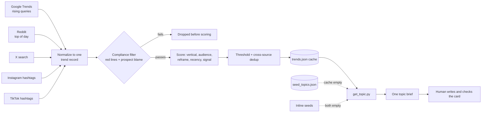

# Trend Scoring Engine

**Outcome: Research in minutes, not days**

> **Details removed.** Company names, people, accounts and data were taken out. The logic is how I built it.

## The problem

A content team had to find timely topics for a B2B brand that sold into several industries. Someone scrolled social feeds and search trends by hand every week. Most of what they found was consumer chatter, off-brand, or framed in a way the brand could never publish. Good topics came in late or not at all.

## What it does

It pulls raw signals from five public sources once a day. It drops anything that breaks the brand's claim rules. It scores the rest on fit and freshness, then serves one topic brief when a writer asks for one. It never comes back empty.



## How it works

1. **Fetch.** `runner.py` calls each source in turn. Each source returns the same record shape: id, title, text, engagement, timestamp, context.
2. **Filter first.** `scoring/compliance.py` rejects text with a red-line claim (free offers, guaranteed savings) or text that blames the buyer. Rejected items never reach the cache.
3. **Score.** `scoring/rank.py` blends five scores with weights from `config.yaml`:
   - vertical fit (keyword hits, capped at 3)
   - audience (B2B words vs consumer words)
   - reframe potential (which story angle the text supports)
   - recency (exponential decay, about 37 percent left after 5 days)
   - signal strength (engagement, log scaled against a per-source baseline)
4. **Dedup.** Exact ids are dropped. Near-duplicate titles across sources are merged with 4-word shingles and Jaccard similarity. The merged record keeps the highest engagement and lists every source it came from.
5. **Serve.** `get_topic.py` picks the top unserved topic, optionally for one vertical. It remembers what it served for 14 days so writers do not get repeats.

## The human check

The engine only suggests. A writer turns the brief into a topic card and checks every claim against a real source before anything is published. The brief carries the gates in plain words: the villain is the system, never the prospect; no invented numbers; no hype.

## Failure handling

- **One bad source never sinks the run.** Rate limits, API errors and missing keys are caught per source, logged to `data/errors.log` as one JSON line each, and recorded in source health.
- **Failed sources keep their voice.** If a source fails, its trends from the last good run are kept and re-scored against the current time, so they age out on their own.
- **Atomic writes.** Cache files are written to a temp file and swapped in, so a crash cannot leave half a file.
- **Three-tier fallback.** Live cache, then curated seeds, then seeds built into the code. The brief says which tier it came from.
- **Corrupt cache** is treated as empty, with a warning, instead of crashing.

## How to run it

```bash
pip install -r requirements.txt
cp .env.example .env              # add your SerpAPI key and Apify token
python3 -m pytest                 # offline tests, no keys needed
python3 runner.py --refresh       # fetch, score, cache
python3 runner.py --print-status  # cache age and per-source health
python3 get_topic.py              # one topic brief
python3 get_topic.py --vertical legal --no-mark-served
```

Run the refresh on a schedule, for example a daily cron line:

```
0 8 * * * cd /path/to/trend-scoring-engine && python3 runner.py --refresh >> data/refresh.log 2>&1
```

Swap the verticals, keywords and phrases in `config.yaml` for your own. The ones shipped here are fictional.

## Files

| File | What it does |
|---|---|
| `runner.py` | Fetch all sources, score, merge with prior, write the cache, print status |
| `get_topic.py` | Pick one topic and print the brief, with the three-tier fallback |
| `config.yaml` | Weights, thresholds, keywords, red lines, source settings (fictional examples) |
| `seed_topics.json` | Curated fallback topics (fictional examples) |
| `scoring/compliance.py` | Red-line and prospect-blame filter |
| `scoring/relevance.py` | Vertical, audience and reframe scores |
| `scoring/recency_signal.py` | Recency decay and engagement strength |
| `scoring/rank.py` | Weighted total, threshold, cross-source dedup |
| `sources/*.py` | One fetcher per source, all returning the same record shape |
| `sources/util.py` | Stable ids, timestamps, error types, required env vars |
| `tests/` | Offline tests for scoring, filters, dedup and failure handling |
| `.env.example` | Placeholder keys |
