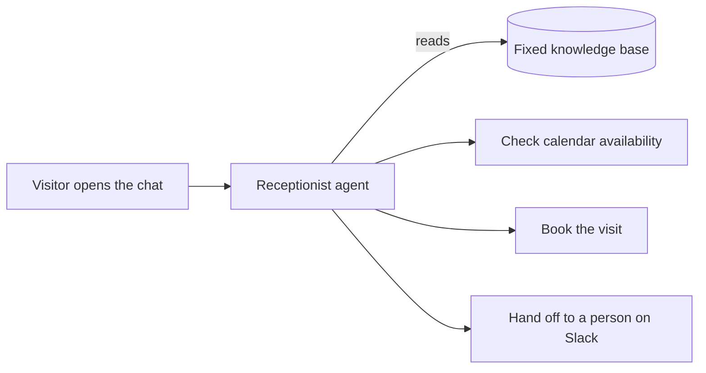

# AI receptionist

**Outcome: Booking support.** A website chat that answers questions, offers real open times, books the visit, and hands off to a person when it should.

> **Built on sample data.** "Brightline Dental" is a fictional clinic. This is how I build it, not a client's live system.

## What it does

The agent runs on Claude with a short memory of the chat. It can use three tools: check availability, book the visit, and hand off.

## The rules it follows

Written into the agent's instructions:

1. Answer only from the knowledge base. If the answer is not there, say so and hand off.
2. Never quote prices, diagnoses or guarantees.
3. To book: ask for name, email and reason, check the calendar, offer two times, then book.
4. Hand off emergencies, complaints and anything it is unsure about.
5. Confirm every booking with date, time and time zone.

## The human check

- A person writes and owns the knowledge base (`sample-data/faq.md`).
- Before go-live I test it with a list of tricky questions: off-topic, price fishing, an emergency, a rude visitor. Each must end in a correct answer or a handoff.
- Handoffs land in a Slack channel a person watches.

## Set it up

1. In n8n: **Import from file** → `workflow.json`.
2. Connect Anthropic, Google Calendar and Slack. Pick the calendar in both calendar tools.
3. Replace the knowledge in the agent's system message with the business's own FAQ.
4. Use the chat's public URL, or embed it on the site.

## Files

| File | What it is |
|---|---|
| `workflow.json` | n8n example authored for 2.47; import unverified |
| `sample-data/faq.md` | Fictional clinic FAQ used as the knowledge base |

## Evidence and configuration limits

Checked 2026-11-16. See `assets/workflow-evidence.json` at the repository root for the exact tested scope. These are inactive examples, not verified production deployments.

- Select an available model in every AI model node. `SELECT_A_MODEL_IN_N8N` is an intentional configuration placeholder, not a model name. The generator accepts `WORKFLOW_ANTHROPIC_MODEL`.
- Schedule timezone defaults to `Asia/Manila`; change it explicitly for the intended operator. The generator accepts `WORKFLOW_TIMEZONE`.
- Connect client-owned credentials and replace every sample recipient, channel, URL, sheet, label ID and calendar.
- Attach an error workflow in each workflow’s settings. Test notification failures separately.
- Use fictional data and isolated accounts first. External services and hosting incur their own charges.
- Human review is specific to each workflow: fixed lead replies and internal briefs send automatically; the receptionist can book events.
