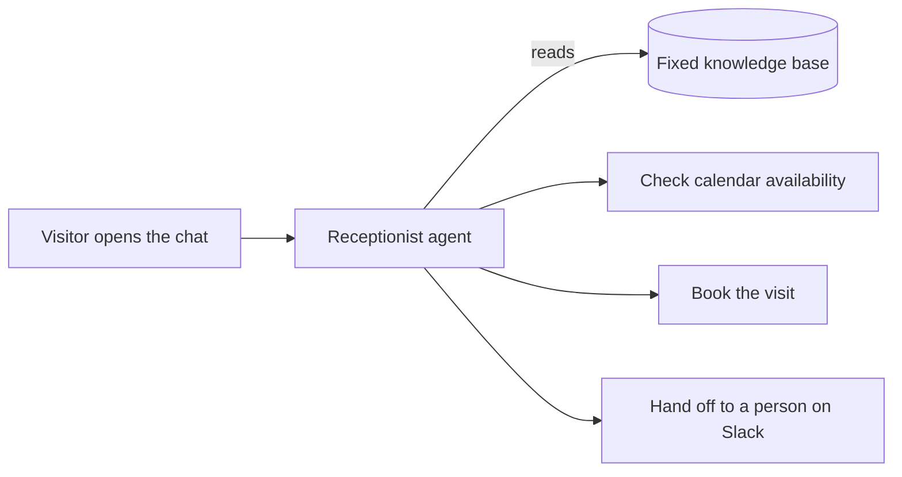

# AI receptionist

**Outcome: More booked calls.** A website chat that answers questions, checks open times and can book the visit. Its rules are instructions, not hard limits, so a person watches the handoffs.

> **Built on sample data.** "Brightline Dental" is a fictional clinic. This is how I build it, not a client's live system.

## What it does

The agent runs on Claude with a short memory of the chat. It can use three tools: check availability, book the visit, and hand off.

## The rules it follows

Written into the agent's instructions:

1. Answer only from the knowledge base. If the answer is not there, say so and hand off.
2. Never quote prices, diagnoses or guarantees.
3. To book: ask for name, email and reason, check the calendar, offer two times, then book.
4. Hand off emergencies, complaints and anything it is unsure about.
5. Confirm every booking with date, time and time zone.

## The human check

- A person writes and owns the knowledge base (`sample-data/faq.md`).
- Before go-live I test it with a list of tricky questions: off-topic, price fishing, an emergency, a rude visitor. Each must end in a correct answer or a handoff.
- Handoffs land in a Slack channel a person watches.

## Set it up

1. In n8n: **Import from file** → `workflow.json`.
2. Connect Anthropic, Google Calendar and Slack. Pick your calendar in both calendar tools. They ship blank on purpose.
3. Replace the knowledge in the agent's system message with the business's own FAQ.
4. Use the chat's public URL, or embed it on the site.

## Files

| File | What it is |
|---|---|
| `workflow.json` | Importable n8n workflow (n8n 2.47) |
| `sample-data/faq.md` | Fictional clinic FAQ used as the knowledge base |

## Property example (Sample)

`sample-data/property-faq.md` is the knowledge for a fictional property manager, Harbor Lane. It covers showings, applications, pets, maintenance and emergencies, and it never quotes rent or deposits.

1. Paste it into the agent's instructions in place of `faq.md`.
2. Ask the four test questions at the end of the file.
3. Expected: it offers a showing, gives no deposit figure, hands the leak to a person and offers owners a call.

Its rules are instructions, not hard limits, so a person watches the handoffs.
