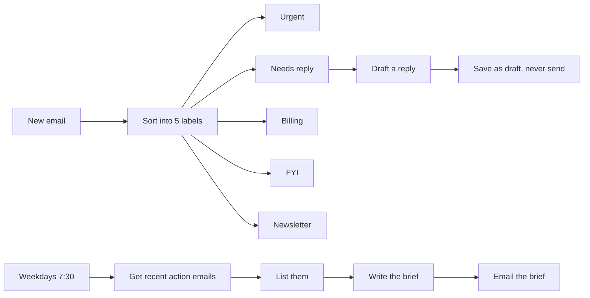

# Inbox triage and daily brief

**Outcome: Recurring admin support.** Every new email is sorted and labeled. Emails that need a reply get a draft. Each weekday morning, one short brief lists what needs the leader.

> **Built on sample data.** The emails are fictional. This is how I build it, not a client's live system.

## What it does

## The human check

- **It never sends a reply.** Drafts wait in Gmail for the leader or assistant to edit and send.
- Anything the AI is unsure of is marked `[CHECK]` in the draft.
- The brief may only use the emails it was given. It is told never to add items.

## Set it up

1. In n8n: **Import from file** → `workflow.json`.
2. Connect Gmail and Anthropic.
3. In Gmail, create five labels: Urgent, Needs reply, Billing, FYI, Newsletter. Pick each one in its matching Label node.
4. Change `you@example.com` in **Send brief to me**.

## Try it on the sample

`sample-data/emails.json` holds five fictional emails, one per label. Pin them to the trigger in n8n to test the sorting without a real inbox.

## Files

| File | What it is |
|---|---|
| `workflow.json` | n8n example authored for 2.47; import unverified |
| `sample-data/emails.json` | Fictional emails for testing |

## Evidence and configuration limits

Checked 2026-11-16. See `assets/workflow-evidence.json` at the repository root for the exact tested scope. These are inactive examples, not verified production deployments.

- Select an available model in every AI model node. `SELECT_A_MODEL_IN_N8N` is an intentional configuration placeholder, not a model name. The generator accepts `WORKFLOW_ANTHROPIC_MODEL`.
- Schedule timezone defaults to `Asia/Manila`; change it explicitly for the intended operator. The generator accepts `WORKFLOW_TIMEZONE`.
- Connect client-owned credentials and replace every sample recipient, channel, URL, sheet, label ID and calendar.
- Attach an error workflow in each workflow’s settings. Test notification failures separately.
- Use fictional data and isolated accounts first. External services and hosting incur their own charges.
- Human review is specific to each workflow: fixed lead replies and internal briefs send automatically; the receptionist can book events.

The Monday brief uses a three-day window; other weekdays use one day. This is not a persistent unread-work queue. Holidays and interrupted runs need an operator check. Select real Gmail label IDs, including Needs review. An empty search may produce no brief.
