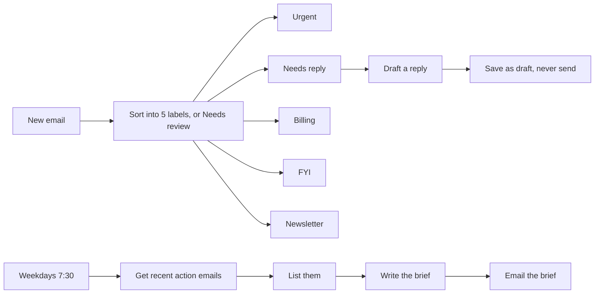

# Inbox triage and daily brief

**Outcome: Hours back every week.** Every new email is sorted and labeled. Emails that need a reply get a draft. Each weekday morning, one short brief lists what needs the leader.

> **Built on sample data.** The emails are fictional. This is how I build it, not a client's live system.

## What it does

## The human check

- **It never sends a reply.** Drafts wait in Gmail for the leader or assistant to edit and send.
- Anything the AI is unsure of is marked `[CHECK]` in the draft.
- The brief may only use the emails it was given. It is told never to add items.

## Set it up

1. In n8n: **Import from file** → `workflow.json`.
2. Connect Gmail and Anthropic.
3. In Gmail, create six labels: Urgent, Needs reply, Billing, FYI, Newsletter and Needs review. Pick each one in its matching Label node. Emails the sorter cannot place get Needs review.
4. The brief covers the last day. On Mondays it covers the last three days, so the weekend is not missed. It runs on Manila time: change the timezone in Workflow settings if needed.
5. Change `you@example.com` in **Send brief to me**.

## Try it on the sample

`sample-data/emails.json` holds five fictional emails, one per label, in the shape the Gmail trigger gives n8n (`from.text`, `subject`, `text`, `id`, `threadId`). Pin them to the trigger to test the sorting without a real inbox. The label and draft steps need real Gmail message ids, so they stop on the sample. That is expected.

## Files

| File | What it is |
|---|---|
| `workflow.json` | Importable n8n workflow (n8n 2.47) |
| `sample-data/emails.json` | Fictional emails for testing |
