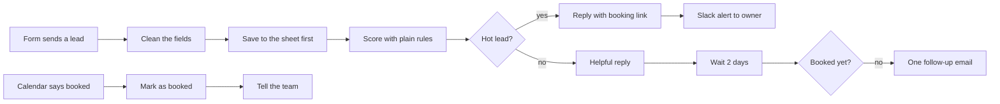

# Lead to booked call

**Outcome: No lead left behind.** Every lead is saved, scored and answered within a minute, then followed up until they book.

> **Built on sample data.** The business, the leads and the emails are fictional. This is how I build it, not a client's live system.

## What it does



1. **Save first.** The lead is written to Google Sheets before anything else runs, so a later failure never loses it.
2. **Score with rules, not AI.** `score-lead.js` adds points for a phone number, a company, budget, source and urgent wording. Every score lists its reasons, so anyone can check it.
3. **Answer fast.** Hot leads get the booking link and the owner gets a Slack alert. Everyone else gets a helpful reply.
4. **Follow up once.** After two days the sheet is checked. If the lead has not booked, one follow-up goes out. Then it stops.
5. **Close the loop.** When the calendar sends a booking, the lead is marked `booked`, so no one gets chased after they book.

## The human check

- The scoring rules sit in one short file. A person reviews them before go-live and after the first 50 leads.
- Hot-lead alerts go to a person, who decides what happens next.

## When something fails

Pair it with [`../weekly-report-error-alerts/error-alerts.json`](../weekly-report-error-alerts/error-alerts.json). Any failed run posts the step, the error and a link to Slack.

## Set it up

1. In n8n: **Import from file** → `workflow.json`.
2. Connect Google Sheets, Gmail and Slack. Create a sheet tab `Leads` with the columns in `sample-data/leads.csv` plus `score`, `tier`, `status`.
   Then pick that spreadsheet in all four Sheets nodes (Save lead first, Record score, Check status, Mark as booked). They ship blank on purpose.
3. Change the booking link (`https://cal.com/your-name/intro-call`) in the three email nodes.
4. Point your form at the `new-lead` webhook and your calendar tool at `booking-made`.

## Test the scoring

```bash
node workflows/lead-to-booked-call/score-lead.test.js
```

It scores the five sample leads and checks each tier.

## Files

| File | What it is |
|---|---|
| `workflow.json` | Importable n8n workflow (n8n 2.47) |
| `score-lead.js` | The scoring rules used inside the Score lead node |
| `score-lead.test.js` | Test against the sample leads |
| `sample-data/leads.csv` | Five fictional leads |
