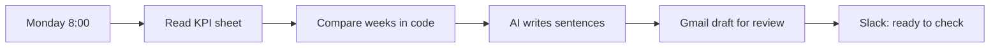
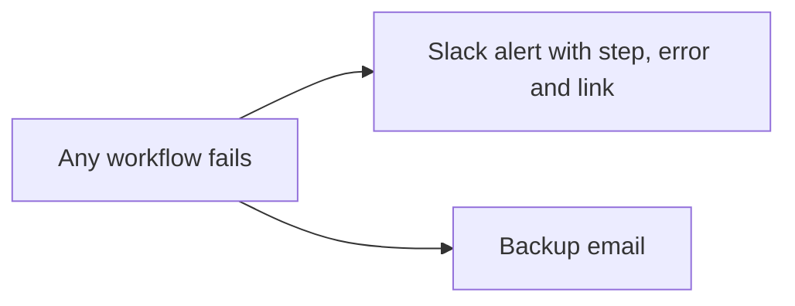

# Weekly report and error alerts

Two small workflows that keep leaders informed and keep automations honest.

> **Built on sample data.** The KPIs are fictional. This is how I build it, not a client's live system.

## 1. Weekly report

**Outcome: Reviewable report drafts.**

- **Numbers are calculated in code**, never by the AI. The code compares the latest two available weeks. It marks current metrics On track or Watch against their targets, and exposes missing current data. With one week, no comparison is invented.
- The AI only writes sentences around those numbers. It is told not to round or add figures.
- The report lands as a **draft**. A person checks it before it goes to the leader.

## 2. Error alerts

**Outcome: Workflow error alerts.**

Set it as the **Error workflow** in each other workflow's settings. Delivery depends on channel configuration and availability. No response-time guarantee is made.

## Set it up

1. In n8n: **Import from file** → `weekly-report.json` and `error-alerts.json`.
2. Connect Google Sheets, Anthropic, Gmail and Slack.
3. Make a sheet tab `KPIs` with the columns in `sample-data/kpis.csv`: `week_start, metric, value, target, direction`.
4. Change `leader@example.com` and `you@example.com`.

## Files

| File | What it is |
|---|---|
| `weekly-report.json` | n8n example authored for 2.47; import unverified |
| `error-alerts.json` | n8n example authored for 2.47; import unverified |
| `sample-data/kpis.csv` | Two weeks of fictional KPIs |

## Evidence and configuration limits

Checked 2026-11-16. See `assets/workflow-evidence.json` at the repository root for the exact tested scope. These are inactive examples, not verified production deployments.

- Select an available model in every AI model node. `SELECT_A_MODEL_IN_N8N` is an intentional configuration placeholder, not a model name. The generator accepts `WORKFLOW_ANTHROPIC_MODEL`.
- Schedule timezone defaults to `Asia/Manila`; change it explicitly for the intended operator. The generator accepts `WORKFLOW_TIMEZONE`.
- Connect client-owned credentials and replace every sample recipient, channel, URL, sheet, label ID and calendar.
- Attach an error workflow in each workflow’s settings. Test notification failures separately.
- Use fictional data and isolated accounts first. External services and hosting incur their own charges.
- Human review is specific to each workflow: fixed lead replies and internal briefs send automatically; the receptionist can book events.

Calculator tests cover single-week input, missing metrics, invalid numbers, duplicates, invalid dates, and nonconsecutive weeks. Numeric validation stops invalid rows before AI summary. Error normalization covers execution and trigger payloads. Notification delivery remains unverified.
