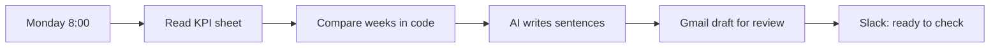
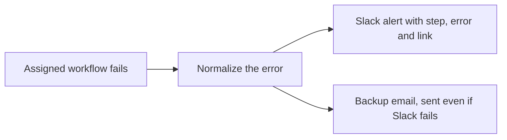

# Weekly report and error alerts

Two small workflows that keep leaders informed and keep automations honest.

> **Built on sample data.** The KPIs are fictional. This is how I build it, not a client's live system.

## 1. Weekly report

**Outcome: Reports that write themselves.**

- **Numbers are calculated in code**, never by the AI. The code compares the two latest weeks on the sheet and marks each metric On track or Watch against its target.
- The AI only writes sentences around those numbers. It is told not to round or add figures.
- The report lands as a **draft**. A person checks it before it goes to the leader.

## 2. Error alerts

**Outcome: Nothing breaks silently.**

Set it as the **Error workflow** in each other workflow's settings. A failed run sends a Slack alert and a backup email. The link to the failed run appears when n8n supplies one. Trigger failures have no run link.

## Set it up

1. In n8n: **Import from file** → `weekly-report.json` and `error-alerts.json`.
2. Connect Google Sheets, Anthropic, Gmail and Slack.
3. Make a sheet tab `KPIs` with the columns in `sample-data/kpis.csv`: `week_start, metric, value, target, direction`. Pick that spreadsheet in the Read KPI sheet node, which ships blank on purpose.
4. Change `leader@example.com` and `you@example.com`.

## Files

| File | What it is |
|---|---|
| `weekly-report.json` | Importable n8n workflow (n8n 2.47) |
| `error-alerts.json` | Importable n8n workflow (n8n 2.47) |
| `sample-data/kpis.csv` | Two weeks of fictional KPIs |
| `compare-weeks.js` | The week comparison, also used inside the workflow |
| `normalize-error.js` | Turns any failure into the same alert fields |
| `report.test.js` | Tests for both: `node --test report.test.js` |
